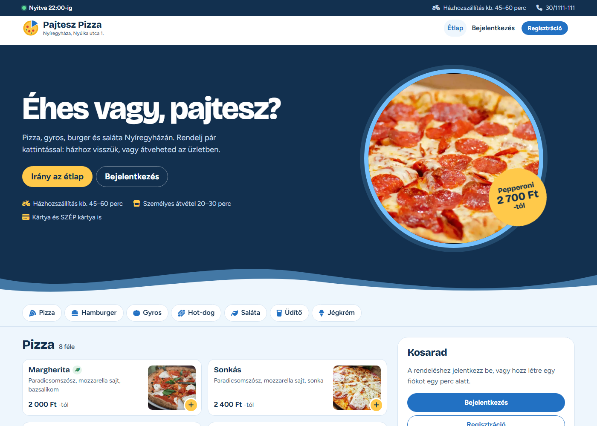
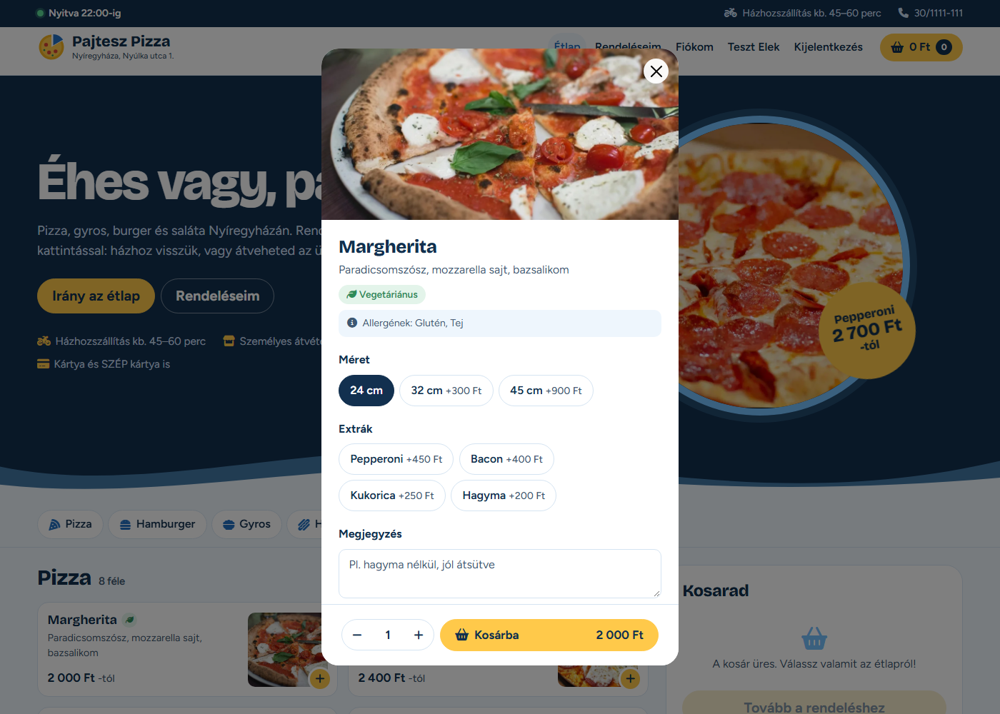
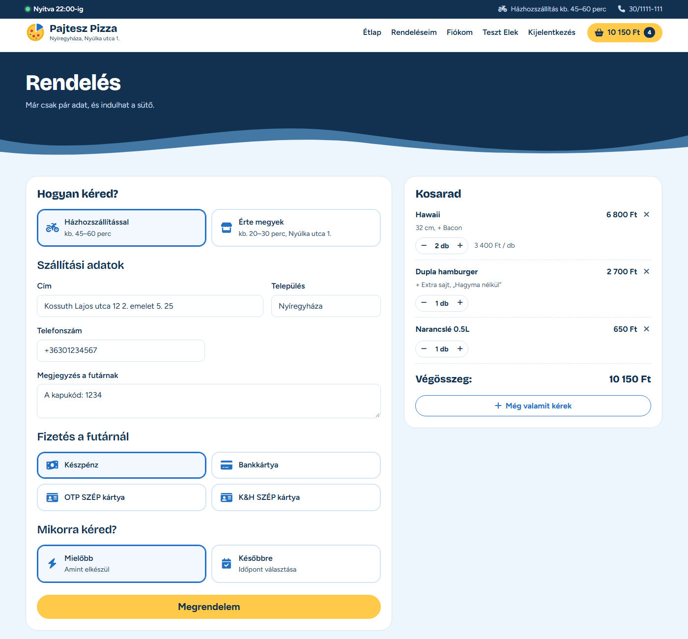
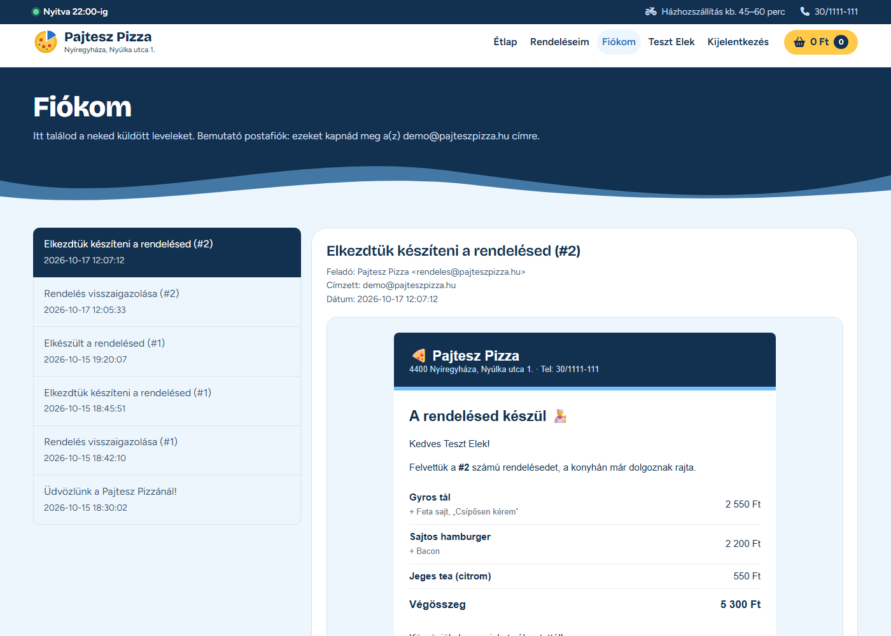
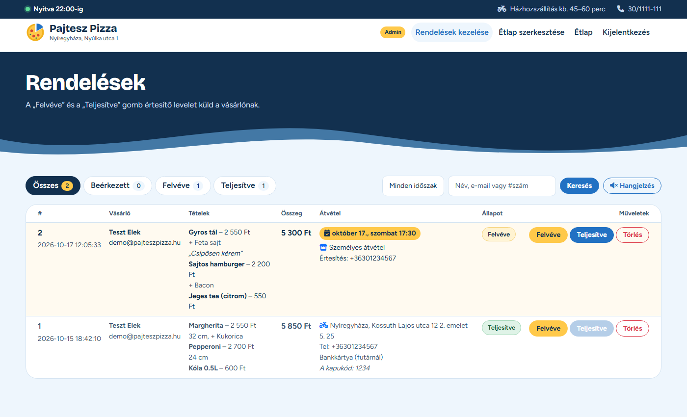
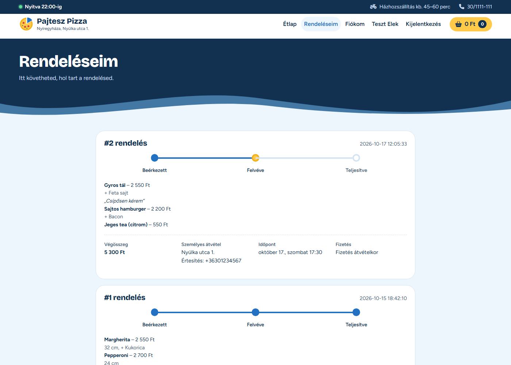
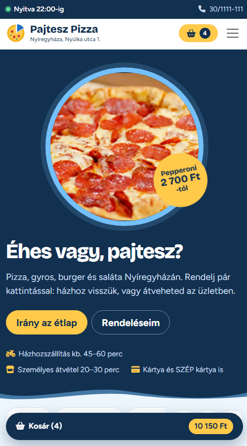
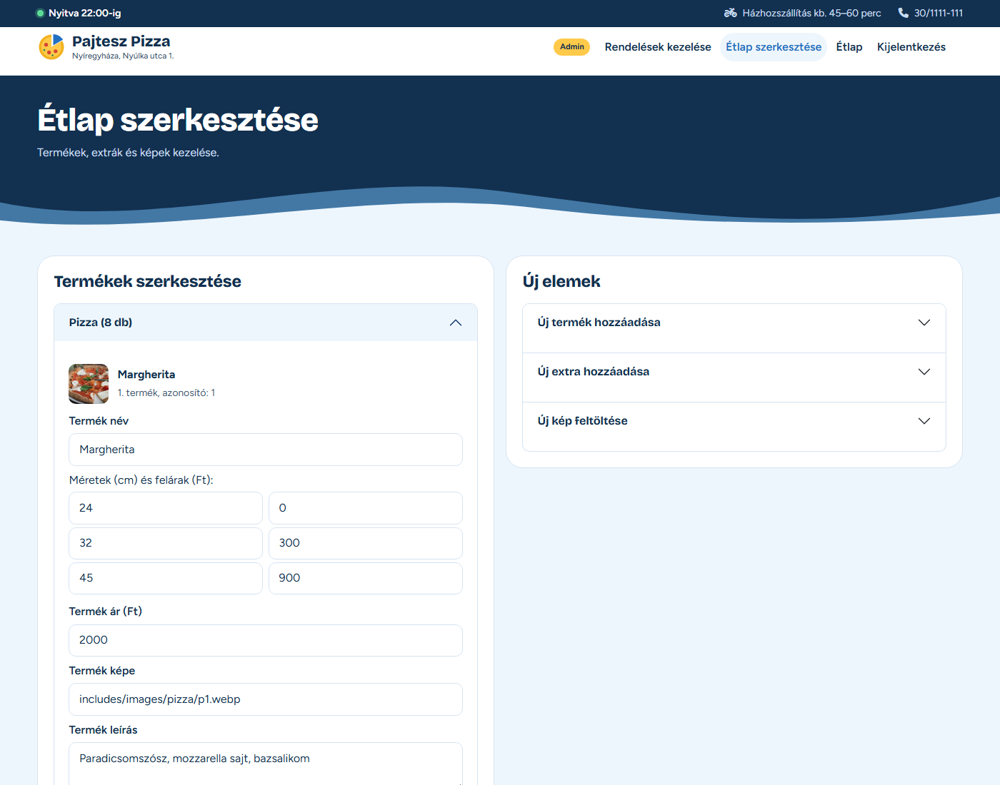

# 🍕 Pajtesz Pizza – online ételrendelő


A **Pajtesz Pizza** egy kitalált gyorsétterem online rendelőfelülete, PHP-ban, keretrendszer nélkül. A vásárlók regisztráció után összeállíthatják a kosarukat (pizzaméret, extrák, mennyiség, megjegyzés), majd házhozszállítással vagy személyes átvétellel rendelhetnek, akár egy későbbi időpontra is. Minden rendelésről visszaigazoló e-mail készül, és a vásárló akkor is értesítést kap, amikor a rendelése készülni kezd, illetve elkészül. Az adminisztrátor kezeli a beérkező rendeléseket és szerkeszti az étlapot.

> **🔗 Élő demó: <http://pajteszpizza.infinityfree.me>** (a belépési adatokat lásd lent, a [Demó fiókok](#demó-fiókok) résznél)
>
> **🔒 Forráskód:** a kód egy privát repóban van. Kérésre szívesen megmutatom: **polak.andras@gmail.com**



## Demó fiókok

| Szerep | Email | Jelszó |
|---|---|---|
| Vásárló | `demo@pajteszpizza.hu` | `Demo1234` |
| Admin | `admin@pajteszpizza.hu` | `Admin1234` |

Mindkét fiók ugyanazon a belépési oldalon jelentkezik be. Az admin belépés után a rendelések kezelésére kerül. A demó vásárlónak már van két korábbi rendelése és néhány levele a **Fiókom** oldalon.

**Kipróbálás pár lépésben:**
1. Lépj be a vásárlói fiókkal, tegyél pár terméket a kosárba, és add le a rendelést.
2. A **Fiókom** oldalon megnézheted a visszaigazoló e-mailt.
3. Lépj be adminként, és a **Rendelések kezelése** oldalon kattints a „Felvéve”, majd a „Teljesítve” gombra.
4. A vásárló **Fiókom** oldalán megjelennek az állapotváltozásról szóló értesítések.

## Funkciók

**Vásárlóknak**
- Étlap kategóriánként (pizza, hamburger, gyros, hot-dog, saláta, üdítő, jégkrém), ragadós kategóriasávval, ami mutatja, hol tartasz az oldalon
- Címkék (vegetáriánus, vegán, csípős) és a főbb allergének termékenként
- Termék kiválasztása felugró ablakban: pizzaméret (24/32/45 cm felárral), extrák, megjegyzés, mennyiség, a gombon élő végösszeggel
- Kosár: mennyiség +/- gombokkal, az egyforma tételek összevonódnak; a fejlécben és mobilon egy lebegő sávban az aktuális összeg
- Nyitvatartás jelzés („Nyitva 22:00-ig” / „Zárva”) a budapesti idő szerint
- Rendelés házhozszállítással (cím, telefonszám, megjegyzés, fizetési mód) vagy személyes átvétellel
- Időzített rendelés: mielőbb vagy egy későbbi időpontra (15 perces sávok); zárva tartáskor előrendelés a következő nyitásra
- Korábbi rendelések állapotsávval (beérkezett, felvéve, teljesítve)
- **Fiókom:** a rendszer által küldött e-mailek (üdvözlés, visszaigazolás, állapotváltozások, jelszó-visszaállítás)
- Regisztráció (az irányítószám alapján a település automatikusan kitöltődik), profil és jelszó módosítása, elfelejtett jelszó
- ÁSZF, adatkezelési tájékoztató, süti tájékoztató
- Reszponzív megjelenés, mobilon is használható

**Adminisztrátornak**
- Beérkező rendelések kezelése: „Felvéve”, „Teljesítve”, törlés. Az állapotváltáskor a vásárló e-mailt kap.
- Új rendelés jelzése: az oldal magától figyeli az új rendeléseket (sáv, jelzés a böngészőfülön, kapcsolható hangjelzés)
- Szűrés állapot és időszak szerint, keresés névre, e-mailre vagy rendelésszámra; az előrendelések időpontja kiemelve
- Étlap szerkesztése: termékek és extrák módosítása, törlése, új termék és új extra felvétele, címkék és allergének
- Termékképek feltöltése kategóriánként
- Demó mód: a nyilvános bemutatón az étlap nem módosítható és rendelés nem törölhető, de a rendelések állapota változtatható

## E-mail értesítések

A rendszer HTML e-maileket készít: üdvözlő levél, visszaigazolás a rendelésről (tételek, végösszeg, szállítási adatok, várható vagy kért időpont), jelszó-visszaállító link, valamint értesítés, amikor az admin felvette a rendelést, és amikor elkészült.

Minden levél adatbázisba kerül, és a vásárló a **Fiókom** oldalon olvashatja (bemutató postafiók), így a funkció levelezőszerver nélkül, a demón is kipróbálható. Valódi küldéshez SMTP is bekapcsolható; az SMTP kliens saját, rövid PHP kód (STARTTLS/SSL, AUTH LOGIN), külső könyvtár nélkül.

## Biztonság

- **SQL injection ellen:** minden lekérdezés prepared statementtel fut
- **XSS ellen:** minden kiírt adat escape-elve jelenik meg, a levelek elszigetelt (sandbox) iframe-ben
- **CSRF védelem:** minden űrlap (a kijelentkezés is) egyedi tokennel védett
- **Az árakat a szerver számolja:** a kosárba csak a választás kerül, az árat mindig az étlapból számoljuk, így a böngészőből küldött ár nem számít
- **Jelszavak:** `password_hash` / `password_verify`; belépéskor és jelszó-visszaállításkor egységes válasz, így nem deríthető ki, mely e-mail címek vannak regisztrálva. A visszaállító tokenből csak a hash kerül az adatbázisba, egy órán át érvényes, egyszer használható.
- **Session:** `HttpOnly` és `SameSite` süti, új session azonosító belépéskor
- **Jogosultság:** szerveroldali ellenőrzés minden oldalon és műveletnél, a szerepet (vásárló vagy admin) adatbázis oszlop adja meg
- **Fájlfeltöltés:** a fájl típusát a tartalma alapján ellenőrizzük, a fájlnév biztonságos, a kategória csak a megengedett lista egyike lehet
- **Demó védelem:** a nyilvános demón a demó fiókok jelszava és e-mail címe nem módosítható
- A beállító, SQL és JSON fájlok böngészőből nem érhetők el, a jelszavak nincsenek a kódban

## Minőség és tesztelés

- **138 végponttól végpontig tartó teszt** (curl alapú), mind sikeres. Lefedik a jogosultságokat, a CSRF védelmet, az árhamisítást, az SQL injection és XSS kísérleteket, a rendelés teljes folyamatát a levelekkel, az előrendelést (rögzített idővel), a jelszó-visszaállítást, az admin műveleteket, a fájlfeltöltést és a demó módot, valamint azt, hogy egyik oldalon sincs PHP figyelmeztetés.
- **GitHub Actions:** PHP szintaxis ellenőrzés PHP 8.0 és 8.3 alatt minden feltöltéskor
- Docker Compose a helyi futtatáshoz

## Technológiák

| Terület | Eszköz |
|---|---|
| Backend | PHP 8 (procedurális, keretrendszer nélkül), mysqli |
| Adatbázis | MySQL / MariaDB (felhasználók, rendelések, e-mailek, jelszó-visszaállítás) |
| Étlap | JSON fájlok (termékek és extrák) |
| Frontend | HTML5, Bootstrap 5.3, Font Awesome, saját CSS és JavaScript |
| Fejlesztői környezet | XAMPP, Docker Compose |
| CI | GitHub Actions |

## Képernyőképek

| Termék kiválasztása | Rendelés és kosár |
|---|---|
|  |  |

| Fiókom (a kapott levelek) | Admin: rendelések kezelése |
|---|---|
|  |  |

| Korábbi rendelések | Mobil nézet |
|---|---|
|  |  |

| Admin: étlap szerkesztése |
|---|
|  |

## Felépítés

```
├── index.php            Főoldal: étlap kategóriánként, kosár
├── pages/               Oldalak (belépés, regisztráció, profil, rendelés, rendeléseim,
│                        Fiókom, elfelejtett jelszó, ÁSZF, adatkezelés, admin oldalak)
├── controllers/         Űrlapok feldolgozása (kosár, rendelés, belépés, admin műveletek)
├── includes/            Közös kód: beállítások, session, adatbázis, segédfüggvények,
│                        e-mail küldés és levélsablonok, fejléc és lábléc, CSS, JS, képek
├── data/                Az étlap (termékek és extrák) JSON-ban
└── database/            Táblák, demó fiókok és mintaadatok (SQL)
```

| Tábla | Tartalom |
|---|---|
| `users` | Felhasználók: név, egyedi e-mail, jelszó hash, szerep, szállítási adatok |
| `orders` | Rendelések: tételek a rendeléskori árakkal és mennyiséggel (JSON), végösszeg, átvételi és fizetési mód, kért időpont, állapot |
| `emails` | A kiküldött e-mailek (a Fiókom oldal tartalma) |
| `password_resets` | Jelszó-visszaállító tokenek (csak a hash), lejárati idővel |

## Képek

A termékképek szabadon felhasználható fotók, főként a [rawpixel](https://www.rawpixel.com/) CC0 gyűjteményéből. Két kép CC BY 2.0 licencű: a Hawaii pizza fotója (szerző: Elsie Hui) és az Extra húsos gyros fotója (szerző: jeffreyw), mindkettő a Wikimedia Commonsról. A képek forrása és licence egyenként: [KEPFORRASOK.md](KEPFORRASOK.md).

## Licenc

Minden jog fenntartva. Ez a repó a projekt bemutatója; a forráskód nem nyilvános, kérésre megtekinthető. A szerző előzetes, írásos engedélye nélkül a projekt semmilyen része nem másolható, nem terjeszthető és nem használható fel. A teljes szöveg: [LICENSE](LICENSE).
